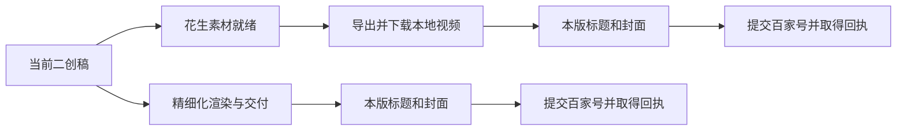

# 历史视频生产与百家号发表

2026-11-01 更新。入口：`/history-scripts?view=uploads`。本页为当前规则；
旧草稿上传、多平台计数及人工上传标记规则不再用于历史视频生产闭环。

## 生产与完成

同一份已保存二创稿按正文 SHA-256 绑定产物。双版生产要求花生版和精细化版，
精细化补做只要求精细化版。每版独立生成标题、横竖封面并自动提交百家号视频，
互不等待。单独关联的视频可以显式准备材料，再明确选择提交。

- 素材就绪：花生平台已准备好素材，可以导出；不代表本地视频已交付。
- 成片交付：存在属于当前稿件版本、可读取的本地视频文件。
- 可发表：成片、标题和横竖封面齐备，没有正在执行、结果待核对或已成功的发表任务。
- 审核中：已取得有效提交回执，平台尚未明确发表。
- 已发表：平台回执明确确认发表。
- 全部已提交：所需视频版本都取得提交回执。保存草稿、人工标记或协调器的完成字段不能代替回执。

## 页面操作

发表列表按视频版本显示状态和数量。默认打开“需处理”，可切换“进行中”、
“可发表”、“审核中”、“已发表”和“全部”。同一稿件的两版分别显示，
一版已提交不妨碍另一版继续制作，也不能重复提交已成功的版本。

选择和预检都传递精确 `videoIds`。全选只选择当前筛选范围内可发表的版本，
不会连带提交同稿的另一版。正常生产材料齐备后自动提交，页面用于查看进度和恢复异常。

`/remotion` 负责制作、预览和下载，其发表状态读取同一份版本状态，标题或封面失败时
也会直接显示。点击发表入口会跳到 `/history-scripts?view=uploads&script=稿件编号&videoId=成片编号`，
只定位指定成片，不会自动勾选或提交；清除定位后恢复全部记录。历史分集编辑页也使用
统一发表入口；只带 `script` 的链接显示该稿件的全部视频版本及其发表任务，仍须明确
选择才能提交。无效定位不会退回全量列表。旧分集发表和确认接口返回 `409` 及
`publicationUrl`，防止绕过统一队列。

同一稿件、同一制作方式已有提交记录后，再渲染的成片属于修订版：即使材料齐备，
也需要明确选择再次发表。旧页面缓存或列表刷新不会把旧版选择继承给修订版。
若原发表仍在排队、执行或结果待核对，修订版会指向原任务，先处理原结果。
另一制作方式和新的稿件正文版本分别计算，不受该修订版规则牵连。

稿件库的“视频已完成”要求所需版本都已交付本地成片；“未提交 / 部分提交 /
全部已提交”按当前稿件的必需视频版本和真实提交回执计算。历史共享视频路径、
旧稿产物和草稿保存凭证不会让新稿完成。

花生制作看板的四个状态为“未开始 / 排队中 / 创作中 / 素材就绪”。
总数覆盖全部任务；任务列表分页加载，可继续读取较早任务。它统计平台制作阶段，
与发表列表的版本数量不同。

## 失败与续接

| 当前情况 | 恢复方式 |
| --- | --- |
| 缺转录、校对或二创稿 | 在稿件详情点击“继续生产”，从缺失检查点继续 |
| 花生导出失败 | 恢复原导出任务，复用已经下载的视频和成功材料 |
| 标题或封面失败 | 在对应版本继续发布准备，保留原视频及已成功材料 |
| 精细化记录完成但缺交付 | 校验并关联原任务成片；文件缺失时明确提示处理 |
| 登录失效 | 在原专用窗口登录后同步，不重复创建项目 |
| 上传失败 | 按原任务检查点恢复；明确未发送的失败才允许重新上传 |
| 发表结果待核对 | 核对原任务绑定页和凭证，不创建第二次发表 |
| 修订成片的原发表尚未结束 | 点击“查看原发表任务”，先恢复或核对原任务，再决定修订版是否再次发表 |
| 旧交付无法确定稿件或版本 | 标记待核对，先恢复或关联真实成片 |

“继续生产”会复用活动任务和已完成产物。未保存修改须先保存；服务端会校验稿件
版本，过期页面收到冲突后需刷新。终止的材料错误显示“需处理”，不会无限伪装成准备中。
刷新页面、重复点击和后台轮询不能绕过原任务身份或重复提交保护。

## 接口与存储

- `GET /api/v1/history-scripts/uploads/candidates`：稿件行包含独立 `versions` 数组。
- `GET /api/v1/history-scripts/uploads/sources/:sourceId/state`：只读返回指定稿件的统一 `production` 状态、原发表任务与队列信息，供 Remotion 使用。
- `POST /api/v1/history-scripts/uploads/versions/:videoId/continue`：传 `sourceId` 和 `expectedScriptSha256`，续接指定版本。
- `POST /api/v1/history-scripts/:id/continue`：传 `expectedRevision`，从稿件缺失步骤继续。
- `GET /api/v1/history-scripts/:id/continuation`：读取原续作任务与“全部已提交”状态。
- 预检和提交接口均支持 `sourceIds` 与精确 `videoIds`；生产仅使用 `baijiahao-video` 和 `publish`。
- 上传任务的恢复、核对和重试接口保留原任务编号和检查点。旧草稿接口仅作兼容，不能完成自动发表。

统一状态读取现有制作、导出、交付、材料和上传记录，并校验本地文件与提交回执。
不新增另一张可漂移的工作流状态表，不清除历史任务或原上传凭证。
修订版状态中的 `revisionOfVideoId` 和 `previousJobId` 指向原成片及原发表任务。
恢复已经发送的任务时继续使用原请求和回执；旧记录缺少成片编号时按确切文件路径
绑定原任务，保留原任务编号，不因重新排队或材料变化创建重复发表。

上传仍复用项目中的 `social-auto-upload` 适配和历史专用账号会话。
登录凭据保存在私有 `data/social-auto-upload/history-sessions/`，任务证据保存在
`data/social-auto-upload/jobs/`；恢复不能随意更换账号或关闭用户其他页面。

详细设计与回归场景见 [生产闭环](history-production-closed-loop.md)，
稿件续作见 [继续生产](history-production-continuation.md)。
早期平台适配诊断见 [旧版历史记录](history-social-upload-history.md)，其旧规则不作为现行状态合同。
