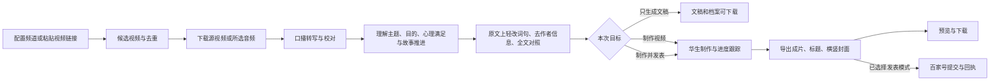

# 奇闻故事内容生产线：需求与功能审查稿

版本：v0.3 · 2026-11-01。用户后续已授权执行，2026-11-02 完成代码与本地工作台接入；实施与验证情况见 [奇闻故事生产线](../mystery-stories-workflow.md)。下文保留当时审查确认的需求，真实来源质量验收尚未执行。

## 1. 产品目标与建议方案

在历史、冷知识科普旁新增独立工作区 **「奇闻故事」**，建议入口 `/mystery-stories`。服务三类内容：真实案件还原、离奇事件与未解之谜、奇趣人物故事。

用户配置 YouTube 来源频道，选择视频或启动批次，系统完成下载、口播提取、原稿理解与拆解、词句轻改、华生制作、成片下载与封面准备。每条内容都保留可回查的原始材料、拆解结果、修改前后文本和制作记录。

本方案的重点是：**理解原稿的主题、讲述目的、观众心理和情绪需求，保留原作者推进故事的全过程，以完整原文为底本，只做必要的词语、句式和作者信息调整。** 原句通顺且适合讲述时可以完全保留；修改必须保持句义、语气和叙事作用。系统不从摘要重新写全文，不把原稿浓缩或拼接成另一篇文章。

用户已明确目标观众为 40 岁以上人群，内容满足其猎奇心理与好奇心。用户原话中的“第教育”暂按“受教育程度不高”理解，教育背景表述仍可校正。相应的人设为：**一位亲切、会讲故事的讲述者，用通俗、具体的中文，把原作精彩的故事讲给 40 岁以上观众听。** 这一受众定位只影响必要的措辞调整；每篇仍保留原作自身的主题、讲述目的和情绪心理满足，不一律改成猎奇故事、知识讲解或人生劝说。

以下为建议默认值，均可在审查后调整：

| 项目 | 建议默认值 |
| --- | --- |
| 工作区名称 | 奇闻故事；名称覆盖案件、事件、人物，不绑定某个来源频道 |
| 内容语言 | 简体中文口播；保留来源原语言、人名原写法及别名，输出可切换繁体 |
| 成片方向 | 以原作的完整讲述和叙事节奏为基准，去除作者及营销信息后按自然口播形成时长；不套固定时长压缩故事 |
| 讲述风格 | 原文已好懂、好听的表达直接保留；需要时只轻改词句，保持人物指代、语气、心理期待和情绪推进 |
| 下载策略 | 默认下载含画面和声音的源视频，以 720p 为参考；可主动选择「仅提取口播」节省空间 |
| 自动化 | 默认一路做到成片与封面；另有「只生成文稿」和「制作并发表百家号」 |
| 文稿检查 | 随时查看、编辑；不要求每条稿件必须人工批准才能制作 |
| 华生账号 | 新工作区独立配置，延续现有工作区身份隔离规则 |
| 视频规格 | 默认期望 16:9；以平台实际支持和确认的参数为准，详情显示实际规格 |
| 视觉方向 | 纪实叙事、人物与地点资料、线索特写、时间提示；配置独立的故事频道风格 |
| 发布 | 默认不启动发布；用户明确选择发表模式后按指定账号执行 |

用户提供的两段频道介绍用于定义内容方向。第一段的频道名称、两者的准确频道 URL 尚未提供；方案不猜测账号，正式使用时在频道管理中录入。

## 2. 已有能力与本次复用边界

已只读查看 `http://localhost:3013/history-scripts`、`http://localhost:3013/science-pop` 的真实页面和当前代码。页面均可打开，无页面脚本错误；本次检查未触发采集、制作或发布请求。

| 能力 | 已有实现 | 新线采用方式 |
| --- | --- | --- |
| YouTube 来源采集 | 历史支持频道、单视频、分页与 video ID 去重；科普在此基础上管理多频道和批次。[E1][E2] | 复用解析和采集能力，新线独立保存频道、来源与批次 |
| 下载与转写 | 两线共用 YouTube 下载底层；当前默认下载压缩音频。已有音频分块、转写缓存和中断恢复。[E3][E4] | 保留现有音频模式，新增完整视频模式；保存来源时间定位 |
| 原稿分析与写作 | 历史有原稿分析、角度、大纲、情绪与依据；科普有材料摘录、叙述结构和知识疑点。[E5][E6] | 复用分阶段调用和保存能力；先分析主题、讲述目的和心理满足，再在原稿上应用保持句义的局部修改 |
| 日常工作台 | 历史有制作、稿件库、采集、发表；科普有单条任务、步骤、文稿、成片、运行记录。[E7][E8] | 保留熟悉的列表加详情结构，突出原稿拆解、逐段对照，故事档案用于辅助回查 |
| 华生制作 | 已有专用账号、项目创建、规划确认、状态查询和恢复；科普自动生产已贯通。[E9][E10] | 复用浏览器和导出适配器，新线独立绑定任务、文稿与账号 |
| 成片与封面 | 已有导出下载、媒体检查、横竖封面与重新设计。[E10][E11] | 复用能力，新增故事封面风格及成片版本绑定 |
| 发表与回执 | 已有百家号发表、上传状态及结果不确定时的恢复；历史按成片版本追踪回执。[E10][E12] | 首版可选接入百家号；按具体成片版本保存结果 |
| 存储与运行恢复 | 已有存储归属登记、清理保护、任务队列、检查点。[E13][E14] | 登记新线文件归属；来源保留规则按故事核对需求单独设置 |

需要新增或适配的事实：

- **“下载源视频”需要补实现。** 当前函数名称带 Video，但实际返回 `downloadKind: 'audio'`；不能据此展示“源视频已保存”。[E3]
- **账号组件目前只有 history/science 两种范围。** 新增第三条线必须扩展账号名、目录、端口及跨工作区身份检查，不能直接传一个新字符串就认为完成。[E9]
- **现有二创提示词带领域设定。** 科普有人设“冷知识讲解员”，历史有不同立场角度要求；新线采用用户确认的“先理解目的和讲法，再保留原文轻改词句”，不继承另选角度、重排故事或整篇自由重写的要求。[E5][E6]
- **华生当前创建接口主要接收文稿与恢复信息。** 独立的配音、比例、视觉说明不是已验证的通用参数；新线应保存制作说明，适配器只执行平台已支持的配置，未能应用的选项明确展示。[E15]

## 3. 用户流程



每条任务可查看中间产物。正常内容自动向前；只有当前阶段确实无法继续时显示具体原因和处理动作，例如转写缺段、关键人物身份矛盾、账号失效、导出结果待核对。

**三个入口：**

1. **单条生产：** 粘贴视频链接 → 选类别和任务目标 → 开始。适合测试频道或制作指定故事。
2. **频道批量生产：** 选频道、目标条数、内容筛选、制作账号及任务目标 → 开始。任务目标、账号、设置在批次开始时留存快照。
3. **人工编辑续作：** 从已保存文稿或异常任务继续。保存修改后仅重做受影响的下游步骤，保留旧版结果。

三种目标分别以「原作拆解及轻改稿可用」「成片及发布包可用」「取得平台提交回执」计数。扫描数、选中数、成功数和失败数分开显示；频道不足以完成目标时说明实际缺口。

## 4. 功能需求

### F01 · 频道与候选素材

- 添加、编辑、停用多个 YouTube 频道；保存规范化频道标识、显示名、标签、默认内容类别与最近采集时间。
- 支持频道列表采集和单视频补充。首版手动触发，定时追更放第二阶段。
- 候选项展示标题、频道、发布时间、时长、封面、原链接；可按日期、时长、关键词和内容类别筛选。采集前的类别取频道默认值或人工标签，生成档案后可修正。
- 同一 video ID 的不同链接合并；重复导入定位到原任务。已失败的来源提供“继续原任务”，不伪装为新素材。
- 首版按人工设置的事件标签查找已有关联故事，支持手动标记同题并保留各自来源；跨频道自动判断“是不是同一案件”放第二阶段，不因标题相似直接删除或合并。
- 支持候选预览后选中制作，也支持按本次筛选条件直接批量制作。
- 首版以一条视频对应一条内容为主。检测到合集时提示包含多段故事，允许选择原稿范围；自动拆成多集放第二阶段。

### F02 · 原视频、口播与校对

- 持久保存源视频或明确选择的音频，记录媒体类型、大小、时长、下载状态和文件指纹。用实际媒体检测结果决定播放器类型。
- 默认完整视频下载失败时显示原因；不静默改成音频后声称已下载视频。
- 复用现有 ASR 分块转写。每段单独保存结果，失败只继续未完成段；完整原稿落盘后再进入理解与轻改。
- 保留“原始转写”和“校对稿”两层。校对人名、地名、日期、数字与标点时保留改动记录，不覆盖原始听写。
- 支持繁简中文、外语来源转为中文讲述；保留姓名原写法、中文译名与别名，不因同音直接合并人物。
- 广告、赞助、频道自我介绍和互动引导可标记为不采用；原材料仍可回查。
- 原稿片段可定位回原视频。ASR 有句级时间码时使用句级；只有分块时间时明确显示“片段范围”，不伪造精确字幕时间。
- 提供源视频播放、原稿搜索、文稿下载，以及“保留原视频”“核对完成后释放”操作；释放前检查文件引用，记录释放原因并保留原稿和来源指纹。该操作只决定媒体保留，不阻断文稿制作。自动回收作为显式设置。

### F03 · 故事档案

系统从校对稿生成辅助档案，用户可修改。档案用于核对人物、事件和材料；写作仍以完整校对稿及 F04 的原作拆解为依据，不仅凭事实摘要另写故事。每条内容都有：

| 区域 | 内容及作用 |
| --- | --- |
| 故事概览 | 一句话事件、主要问题、类别、国家地区、发生时间、已知结局 |
| 人物表 | 姓名、别名、角色、关系；区分被提及、被怀疑、被起诉、被判决等不同状态 |
| 事件时间线 | 事情真实发生的顺序，用于核对；与原作讲述顺序分别保存，不用它自动重排原作的倒叙或插叙；日期不明时保留原有精度 |
| 关键线索 | 谁发现了什么、改变了哪项判断、对应哪段来源 |
| 说法与依据 | 主张、提出者、原文摘录、URL、片段时间或文档位置、依据状态 |
| 矛盾与未知 | 不同来源的冲突、资料缺失、尚无结论的问题，以及本稿采用的表述 |
| 信息截止时间 | 目前结论依据何时的资料；后续更新关联到原故事 |

“来源确实这样说”与“事件已被独立证实”分别记录。依据状态建议为：来源陈述、已有可查证支持、存在争议、明确属于推测、已被后续资料推翻。

首版可手动补充报道、公告或判决等资料的链接与摘录。标记“已有可查证支持”必须附具体支持材料及核对记录；只存一个链接、模型记得某事、重复出现于两个转载视频，都不能自动升级为已证实。

来源频道信息保存在后台档案中，轻改稿去掉频道自我介绍与营销。原稿中的“据报道”“警方认为”等事实归属及不确定表述予以保留；作者的亲历描述按真实归属转为第三人称，不能变成当前讲述者的亲历。未破案件保留原作的已知线索和未解问题。

### F04 · 原稿理解与词句轻改

**理解得充分，改动得克制。** 中文原稿默认保留原文，只做必要的近义词替换、等义句式调整和作者信息处理。每句的意思、语气及叙事作用保持；原本通顺的句子可以完全不改，不设必须修改的比例。

第一步：读懂这篇原稿“为什么讲、怎样讲”。

| 拆解项 | 需要记录的内容 | 对轻改的约束 |
| --- | --- | --- |
| 主题 | 原稿围绕什么核心关切展开，讲述者的态度是什么，结尾回到什么问题 | 保留原主题、态度与结尾指向；事件名称不等于主题 |
| 讲述目的 | 原稿为什么选择这些材料和顺序，希望观众听完获得什么体验或认识 | 保留原作想完成的事情，不另加知识教学、价值升华或人生劝说 |
| 观众心理满足 | 原作让观众期待什么、为什么愿意继续听、最后兑现了什么；可涉及解谜、猎奇、共情、危险感与释放、正义期待等 | 依据具体原文识别主要和次要需求，不给所有故事套同一种“好奇心”标签，也不凭空增加满足点 |
| 故事推进 | 原作者用什么问题、细节或行动推动下一步；上一段如何引出下一段，信息如何逐步增加 | 保留完整推进链、原顺序、过渡和铺垫；倒叙、插叙、回扣按原作保留 |
| 情绪弧线 | 每段让观众产生什么感受，哪些材料触发变化，如何积累、转折及收束 | 保留具体触发材料和感受形成的过程，不能只保留情绪标签或高潮结果 |
| 好奇与悬念 | 哪个问题在何处提出、维持、误导或解答，哪些信息此时尚未揭晓 | 按原位置揭示，不能提前告诉观众后面的身份、证据和结局 |
| 讲述方法 | 场景、动作、设问、对比、原有类比、幽默、停顿、反复强调等如何服务主题和情绪 | 保留原作的方法及其具体材料，措辞轻改不替换成另一套比喻或套路 |
| 作者痕迹 | 频道名、自我介绍、身份信息、广告及营销的具体位置，与故事正文是否交织 | 精确处理身份和营销，不把故事性开场、情绪铺垫或必要归属一并删去 |

拆解先形成全篇的“主题、目的与观众期待”说明，再逐段定位具体原文依据。对于作者意图，只记录能从原稿观察或有依据推断的内容，推断注明依据；无法判断时不虚构立意。每段同时记录原句范围、在推进中的作用、情绪触发、与前后段的关系、观众已知和未知的信息。此拆解用于约束修改，不作为重新创作的大纲。

第二步：在原文中标记需要处理的作者信息。

- 去掉“我是某某、这里是某频道”、作者专属称呼、广告和订阅引导，来源信息留在后台。
- 自我介绍与悬念同处一段时，只移除身份片段，保留原来的入题方式、疑问和铺垫。
- 人物姓名、身份、证词、必要的报道归属属于故事正文，不因出现名字或第一人称就删除。
- 作者的“我采访过、我去过现场”按真实归属作最小必要的人称调整；保留原事实、语气及其在故事中的作用，不能变成当前讲述者的亲历。

第三步：以完整原稿为底本，应用少量等义修改。

- 原句已经好懂、自然、符合口播时直接保留。允许完全不改，不为降低相似度、生造“自己的风格”或达到改动率而换词。
- 需要调整时，只在原句附近替换少量词语、调整语序或拆分长句；保留该句全部信息、动作过程、程度、否定、条件、因果、先后、推测和评价态度。例如“可能”不能变成“就是”，“没找到”不能变成“不存在”。
- 同义词选择结合整段语境、原语气和词语搭配，不机械替换字面近义词。原来的类比、幽默、场景细节和强调可以直接保留，不另造同功能素材。
- 40 岁以上受众的人设仅用于必要的用词和称谓调整；可将不清楚的指代换成原文已明确的姓名或身份，不添加解释段、生活案例、感想或教育性结论。
- 生成方式采用“原文 + 局部修改清单”。模型提出每处原文、替换文字和理由，系统将这些修改应用到完整原稿上；清单之外的文字原样保留。禁止用摘要、事实表或拼接的原文摘录生成全文。
- 删除仅限已标记的作者/营销信息及其必要处理。叙述正文的句子、细节、重复铺垫、转场和过程不能以“精炼”“提高信息密度”为由删除或合并为概要。
- 每次局部修改都参考所在完整段及前后文。长稿分块只划分处理范围，保留原顺序和边界原文，不能把各块独立改写成摘要后拼接。
- 外语来源以逐句保留原意的中文翻译作为底稿，再遵循同一轻改规则，不先翻成故事梗概。原始外文和译文对应关系保留。
- 正文只包含要朗读的文本，拆解、修改理由和核对说明不进入配音。时长随完整原稿自然形成，不按目标字数压缩；超过平台已核实限制时保存全文并提示处理，不自动删节。当前科普的 10000 字符限制仍需适配核实。[E10]

第四步：同时检查句义、完整性、连贯性和原作体验。

| 检查层面 | 判定依据 |
| --- | --- |
| 句义 | 每处替换与原句等义；主体、动作、事实、限定、语气、判断强弱及因果保持 |
| 完整性 | 所有非作者/营销的原稿内容都有对应位置；过程没有被缩成结论，铺垫、转场和细节没有消失 |
| 连贯性 | 全文连读时，指代、时间、语气、连接词、铺垫与回扣自然衔接，分块处无重复、漏句和突兀跳转 |
| 主题与心理体验 | 主题、讲述目的、原作者的推进方式、观众期待及情绪兑现保持，结尾仍回答原作的问题 |

检查输出具体问题位置和最小修正建议，不再生成另一版全文。普通措辞替换拿不准是否更自然、是否等义时恢复原句；作者身份处理无法妥善完成时标记该处需要处理。事实疑点转回独立校对流程并留记录，不能在轻改阶段悄悄变更原文结论。

允许配置讲述者称呼、称谓习惯和繁简体；口语化只做必要且等义的调整。主题、目的、心理满足、推进顺序、句义和完整性是约束，不作为可调节的“创意强度”。轻改结果不以“改动多、篇幅短、看起来新”作为质量标准。

### F05 · 原稿对照与词句轻改

编辑界面以完整原文为底稿：左侧原稿，右侧轻改稿，中间可展开“主题目的、观众心理、故事推进与情绪”拆解。高亮每处实际修改，点开可见原句、新句和修改理由；未改动内容正常保留，窄屏使用页签。

| 编辑动作 | 作用与边界 |
| --- | --- |
| 轻改选中词句 | 只提出保持句义和原语气的局部替换，合适的原句可不改 |
| 换成更好懂的说法 | 换用语境合适的常用词、等义语序或拆句，不新增解释和案例 |
| 去除作者信息 | 定位并处理作者身份及营销片段，保留原开场、故事材料和过渡 |
| 保留原句 / 撤销本处修改 | 直接还原选中位置，避免反复生成越改越远 |
| 检查全文连贯性 | 显示指代、转场、语气、分块边界及铺垫回扣的问题，只修改明确问题 |
| 查看修改 / 恢复版本 | 查看全部替换和删除理由，恢复上一版或原稿底稿 |

- 手工编辑保留；自动操作统一为局部轻改，不再提供“重写这一段”或“增强故事性”等自由生成入口。
- 逐句显示对应关系，同时按完整讲述段检查推进和语气。拆句后仍对应原句，不将机械逐句替换当成自然连贯的证明。
- 所有删除必须有原文位置和明确理由；作者/营销范围之外的正文缺失或语义省略属于不合格，不以字数差异小为由放行。
- 每版保存原稿、拆解版本、主题和心理目的、人设、修改清单、对应关系及四层检查结果；可查看为何改动，也可直接保留原文。
- 校对稿或拆解更新后，定位受影响处重新检查；后台更新不覆盖人工稿。切换任务、刷新列表和保存冲突时保留未保存编辑。
- 华生制作绑定已保存的具体版本。后续改稿另存，保留旧成片，不把旧视频标成新稿结果。
- 默认自动检查并仅修明确问题，不增加逐条人工批准。修正优先恢复原句及原有衔接；仍存在句义变化、正文缺失、僵硬拼接或主题目的偏离的版本不送入华生。

### F06 · 华生制作

- 任务绑定新工作区的华生账号、已保存稿件版本、稿件指纹及制作配置快照。
- 复用当前“素材剪辑成片”路径：提交文稿、确认平台规划、观察制作、导出下载，始终沿原项目继续。[E15]
- 保存独立制作说明：纪实叙事、期望画幅、配音偏好、字幕偏好、章节提示、视觉参考。区分“已请求”和“平台已确认应用”。
- 只把口播正文送入朗读内容。平台不能独立承接的参数显示未应用并提供原项目入口，不把控制文字拼进正文碰运气。
- 原视频用于转写和核对，不默认整段转投华生；真实资料与示意素材分别标记，不能把素材库随机人物当成案件当事人。
- 首版不承诺华生能自动制作准确的人物关系图、地图或证据动画；精确图形作为后续增强。
- 沿用标准模式与现有额度判断，额度不足保留原项目，不自动切换付费快速模式。[E16]
- 同账号操作排队；账号登录失效只暂停该账号相关阶段，已完成原稿、轻改稿、其他账号任务继续保留。

### F07 · 成片、封面与交付包

- 展示本地制作任务、华生远端状态、导出状态和本地文件状态，不用一个“完成”混在一起。
- 华生素材就绪后启动导出；文件实际下载、媒体检查通过、绑定当前版本后才展示“成片可用”。
- 成片内嵌预览；展示时长、实际分辨率、文件大小、所属稿件版本和原华生项目。
- 自动生成标题候选、推荐标题、简介、标签，以及横版和竖版独立构图的封面。标题、封面不能增加正文没有的案件结论。
- 封面可单独重做、修改短标题和设计指令；封面失败不重做视频。
- 独立故事封面方向：明确人物/地点/关键物件与一个疑问，少量醒目文字；具体案件资料与示意图片可辨，不套用科普主体海报的人设和文案。
- 可下载 MP4、文稿 TXT/Markdown、原稿拆解与对照、来源与故事档案、发布文案、封面和版本清单；支持整包导出。
- 源视频转写的时间码只对应源视频。成片字幕仅在取得成片实际字幕或完成另行对齐后提供；缺少时显示“暂无字幕文件”，不把源视频 SRT 当作新视频字幕。

### F08 · 可选百家号发表

- 提供「制作并发表百家号」模式和成片页的手动发表入口，默认任务目标仍是制作视频。
- 启动发表时绑定具体视频版本、发布文案、封面、目标账号及平台声明选择，不继承科普活动标签等领域配置。
- 展示“待上传、上传中、已提交待审核、已发表、结果待核对、失败/暂停”，每项附原任务与回执。
- 已有成功提交回执不重复发表。请求已发出但结果不确定时先核对原编辑页或原任务，不能直接重传。
- 文稿或封面后来修改不改变已发出请求的内容；需要重发时作为新版本显式操作。

抖音、视频号、公众号文章和多平台分发放第二阶段。用户批准本需求或开发方案，不等于启动实际频道采集、付费制作或公开发布。

### F09 · 批量运行与异常恢复

- 批次显示扫描、跳过、选中、各阶段产出、失败数和当前执行项；可按频道、类型、状态、账号筛选。
- 支持暂停新增处理、停止本机执行、继续原任务、只重试失败项；按钮说明影响范围。
- 关闭页面不取消已接受的后台任务。用户主动停止的任务不在服务重启后自行恢复。
- 普通网络读取可有限重试；创建项目、导出和发表结果不确定时先核对远端，保留原编号。
- 单条素材不可用、单张封面失败不阻塞无关条目；登录、额度、磁盘不足等共享阻塞暂停受影响队列。
- 列表和统计按全量数据分页计算；完成数量不能只数第一页，亦不能把“提交制作”当作“已有成片”。
- 每条日志说明当前步骤、错误、已保留产物和下一动作；操作记录与来源链接对用户可见。
- 删除为归档隐藏，执行中须先停止。释放文件由存储引用检查处理，不破坏原项目恢复或发表结果核对所需资料。

## 5. 页面设计

主导航新增「奇闻故事」，沿用现有中文生产工具的布局和视觉样式。默认打开生产工作台，顶部常驻「导入视频」「批量采集」「华生账号」「设置」。

| 一级视图 | 主要用途 | 主要内容 |
| --- | --- | --- |
| 生产工作台 | 看今天在做什么、从哪里继续 | 状态筛选、任务列表、当前阶段、异常动作、批次进度 |
| 故事库 | 查阅、理解和轻改内容 | 搜索、类别、频道、原稿分析、轻改版本、人物/事件标签、同题关联 |
| 频道采集 | 配置来源和检查采集结果 | 频道列表、候选预览、筛选、采集批次及日志 |
| 成片与发表 | 使用已完成作品 | 视频预览、下载包、封面、发布文案、可选百家号操作与回执 |

选中任务后，详情有六个页签：**原视频与口播 / 原稿理解 / 轻改稿 / 华生制作 / 成片与封面 / 运行记录**。“原稿理解”先展示主题、目的和观众心理，再展示推进方式、情绪弧线与讲法；故事档案用于辅助回查。“轻改稿”提供完整原文对照、修改清单和恢复原句操作。

桌面结构示意：

```text
奇闻故事                [导入视频] [批量采集] [华生账号] [设置]
生产工作台 | 故事库 | 频道采集 | 成片与发表

类别 / 频道 / 状态 / 搜索
┌─────────────────────┬────────────────────────────────────────┐
│ 任务列表             │ 当前故事 · 类别 · 本次目标 · 稿件版本    │
│ 标题、频道、进度     │ 素材 → 口播 → 理解 → 轻改 → 制作 → 成片 │
│                      │                                        │
│ 当前选中             │ 原稿 | 理解 | 轻改 | 制作 | 成片 | 记录 │
│ 异常原因与继续入口   │                                        │
│                      │ 当前产物 / 编辑区 / 依据侧栏             │
└─────────────────────┴────────────────────────────────────────┘
```

交互要求：列表切换保持筛选；跨视图继续选择同一故事；查看平台项目不自动重试任务；移动端采用列表与详情分层，编辑正文和恢复按钮可使用。

## 6. 状态与完成标准

过程按「导入 → 下载 → 转写与校对 → 理解原稿主题目的与讲法 → 词句轻改及全文对照 → 华生制作 → 导出 → 包装 → 可选发表」推进。故事档案随原稿分析保存。需要处理、用户暂停、远端结果待核对为明确的例外状态，保留当前阶段。

| 页面状态 | 必须有的证据 |
| --- | --- |
| 原稿可用 | 所有转写块已保存，来源媒体指纹与原稿匹配 |
| 文稿可用 | 原作主题目的与推进拆解、人设快照、完整轻改稿和修改清单已保存；句义、完整性、连贯性与原作体验检查无未解决的关键问题 |
| 华生排队/制作中 | 平台确实接受并提供当前项目状态，不能只看本地点过按钮 |
| 平台素材就绪 | 平台结果表示可进入导出；不代表本地已有视频 |
| 成片可用 | 本地文件存在、媒体检查通过、与当前制作版本对应 |
| 发布包可用 | 成片、选定标题、文案和所需封面均有效 |
| 已提交待审核 | 保存平台提交回执及作品标识 |
| 已发表 | 平台结果明确显示已发表；不能由上传 HTTP 成功推断 |

例如：文稿 v2 已提交制作，此时人工保存 v3。v2 的成片继续归属于 v2；v3 显示尚未制作。恢复 v2 导出不会把 v3 误标为完成。

## 7. 首版与后续范围

| 阶段 | 包含功能 | 用户得到的结果 |
| --- | --- | --- |
| P0 · 首版 | 独立工作区、频道/单视频采集、去重、媒体与转写、主题目的及叙事拆解、辅助故事档案、原文局部轻改、句义及全文对照、版本、华生制作、导出、封面、批次恢复、可选百家号 | 尽可能保留原文、推进方式及情绪心理满足，只做必要等义调整，得到可回查和下载的成片 |
| P1 · 内容研究增强 | 定时追更、跨频道同案合并、同题相似性识别、自动补充外部资料并核验、后续进展提醒、字幕优先提取、合集自动拆分 | 同案多来源研究、更少重复选题、持续追踪新进展 |
| P2 · 表达与分发增强 | 人物关系图、精确时间线/地图动画、Remotion 精制版、多平台分发、公众号改写、经对齐的成片字幕、成片质量辅助检查 | 更丰富的视频表达和多种内容交付 |

首版拟提供“补充资料”和“关联同题”入口，但不把模型自动联网研究、自动合并案件或实时追踪当作已实现能力。首版只制作华生版，避免历史双版本流程扩大交付范围。

## 8. 验收清单

以下为未来实施验收标准，本次仅完成需求设计，没有执行这些生产验收。

| 编号 | 场景 | 通过标准 |
| --- | --- | --- |
| A01 | 新建与返回工作区 | 导航入口可达；任务、频道、账号数据与历史/科普隔离 |
| A02 | 重复导入 | 同一视频两种 URL 只生成一个来源；重复开始请求不会重复创建制作项目 |
| A03 | 两种下载模式 | 完整模式得到可播放的画面和声音；音频模式准确标注；失败不冒充另一种模式成功 |
| A04 | 长视频转写中断 | 人为中断一块后恢复，已完成块不再调用 ASR，最终原稿覆盖全部选定内容 |
| A05 | 人物和线索 | 每个关键事实可打开对应摘录及位置；别名可回查；不确定日期没有被补成确定日期 |
| A06 | 原作结构、情绪与讲法 | 案件、离奇事件、人物各取一条素材；所有关键叙事段、情绪节点及触发材料、讲述方法均能定位到轻改稿；结构顺序、悬念揭示位置、结尾作用与原作相符，人物和数字无无依据变更 |
| A07 | 未解或冲突素材 | 未解故事可保留未知并正常完成；核心身份/结局矛盾未解决时精确提示阻断点 |
| A08 | 去作者信息与克制修改 | 只清理指定作者及营销片段，保留其中交织的故事正文；亲历不转嫁；原本合适的句子可原样保留；未额外添加解释、例子、评价或结论 |
| A09 | 局部编辑与版本 | 每处修改均可定位原文和理由，修改范围外文字原样保留；撤销某处精确恢复原句；上游更新、未保存编辑及成片版本归属处理正确 |
| A10 | 自动生产 | 对账号有效且无内容阻断的任务，选制作模式后无需逐条审批文稿，完成华生项目、导出及本地 MP4 |
| A11 | 远端失败恢复 | 在创建/导出返回不明时恢复原编号；更换默认账号不改变已有任务绑定 |
| A12 | 成片与包装 | 视频实际可播且有音轨；封面失败只补封面；下载包的文稿、图片、视频版本一致 |
| A13 | 批次和停止 | 5 条候选中制造 1 条素材不可用失败，其他可处理项继续；重复恢复不重复产出；主动停止后重启仍停止 |
| A14 | 可选发表 | 仅制作模式无上传请求；发表模式绑定指定账号和版本；重复点击复用原记录，区分提交与发表 |
| A15 | 存储 | 原稿核对期间所需媒体可访问；清理不删除被使用或明确保留的文件；空间不足保留检查点 |
| A16 | 界面 | 1440px 与 390px 下主要动作可见、无横向溢出；长标题、空列表、失败状态均有明确表现 |
| A17 | 主题、目的与心理满足 | 三类样稿分别有带原文依据的主题、讲述目的和观众期待分析；轻改后主题、态度、推进链、结尾兑现与原作一致，不因目标人设变成另一种内容 |
| A18 | 不浓缩、不改句义、不僵硬拼接 | 非作者/营销正文全部有对应内容；过程、铺垫和转场完整；修改保持主体、限定、因果和语气；全文及分块边界连读自然；删过程、把“可能”改为确定、漏句或突兀拼接的样例应被识别并修复 |

故事质量验收以 A06–A09、A17–A18 的真实样稿对照和全文朗读为准：先核对是否理解原稿主题目的及观众心理，再检查是否保持原句义、推进过程和听感。原作铺垫被删、情绪只剩标签、答案提前透露、故事浓缩、语义漂移或段落僵硬拼接均不合格；改动少或保留原句不扣分。规则已明确不代表生成效果已验证，实施时必须用实际样稿证明。视频质量看实际成片，不能用“已提交华生”代替交付。

## 9. 已明确的写作原则与其余产品选择

用户已明确：理解原稿主题、目的，以及它满足观众的何种情绪和心理；保留原作者推进故事的方法及完整过程，尽可能保留原文，只做不改变句义的词语和句式轻改，并处理作者信息。禁止浓缩和僵硬拼接，原句合适时可不改。目标观众仍为 40 岁以上人群；人设适配服从每篇原作的目的和体验。这些已写入 F04、F05 和验收，不再作为待选择的路线。“第教育”的具体含义保留前述暂定理解。

可以直接按 F01–F09 编号提出修改。其余产品建议如下：

| 选择 | 本稿建议 |
| --- | --- |
| 名称与分类 | 「奇闻故事」；案件 / 离奇事件与未解之谜 / 人物故事三类 |
| 来源范围 | 先以指定 YouTube 频道和单视频为入口；准确 URL 在配置时录入 |
| 下载与保留 | 默认完整视频，核对完成前保留；可主动选择仅音频 |
| 自动化程度 | 默认自动做到成片；可选只生成文稿，无通用人工审批关卡 |
| 成片规格 | 中文、保留原作完整讲述形成自然时长、期望横版 16:9；平台限制单独适配 |
| 首版发布范围 | 百家号作为明确选择的可选分支；其他平台后续扩展 |

下一步是根据用户审查修改本方案，再进入开发；本轮交付到需求方案为止。

## 10. 现状证据

以下引用说明当前复用基础；F01–F09 中的新增能力是拟建设需求。

- **[E1]** [YouTube 频道与单视频采集](/Users/zhangshijie/Documents/workspace/huobao-drama/backend/src/services/history-source-youtube.ts:201)：分页、候选、video ID 去重。
- **[E2]** [科普批次服务](/Users/zhangshijie/Documents/workspace/huobao-drama/backend/src/services/science-collection.ts:90)：频道设置、目标、执行与续跑。
- **[E3]** [现行 YouTube 下载](/Users/zhangshijie/Documents/workspace/huobao-drama/backend/src/services/history-source-youtube.ts:247)：音频格式、文件校验和下载类型。
- **[E4]** [科普分块转写](/Users/zhangshijie/Documents/workspace/huobao-drama/backend/src/services/science-workflow-media.ts:131)及[历史时间码汇总](/Users/zhangshijie/Documents/workspace/huobao-drama/backend/src/services/history-source-pipeline.ts:546)：缓存与时间定位。
- **[E5]** [历史二创规则](/Users/zhangshijie/Documents/workspace/huobao-drama/backend/src/services/history-script-recreation.ts:27)：历史领域写作与角度约束。
- **[E6]** [科普写作服务](/Users/zhangshijie/Documents/workspace/huobao-drama/backend/src/services/science-script.ts:237)及[固定人设](/Users/zhangshijie/Documents/workspace/huobao-drama/backend/src/services/science-script.ts:8)：分析、写作与领域耦合。
- **[E7]** [历史工作区视图](/Users/zhangshijie/Documents/workspace/huobao-drama/frontend/app/pages/history-scripts.vue:750)。
- **[E8]** [科普详情页签与步骤](/Users/zhangshijie/Documents/workspace/huobao-drama/frontend/app/pages/science-pop/index.vue:205)。
- **[E9]** [账号范围](/Users/zhangshijie/Documents/workspace/huobao-drama/backend/src/services/huasheng-accounts.ts:10)、[账号标识](/Users/zhangshijie/Documents/workspace/huobao-drama/backend/src/services/huasheng-accounts.ts:67)、[跨工作区身份检查](/Users/zhangshijie/Documents/workspace/huobao-drama/backend/src/services/huasheng-accounts.ts:189)。
- **[E10]** [科普自动生产服务](/Users/zhangshijie/Documents/workspace/huobao-drama/backend/src/services/science-workflow.ts:313)：准备文稿、账号排队、制作、导出、包装和发表；[移除文稿批准阶段](/Users/zhangshijie/Documents/workspace/huobao-drama/docs/science-auto-production-20261031.md:3)。
- **[E11]** [科普横竖封面生成](/Users/zhangshijie/Documents/workspace/huobao-drama/backend/src/services/science-cover-poster.ts:164)。
- **[E12]** [历史成片版本模型](/Users/zhangshijie/Documents/workspace/huobao-drama/backend/src/services/history-production-state.ts:13)及[提交回执判定](/Users/zhangshijie/Documents/workspace/huobao-drama/backend/src/services/history-production-state.ts:60)。
- **[E13]** [文件归属与引用登记](/Users/zhangshijie/Documents/workspace/huobao-drama/backend/src/services/storage-artifacts.ts:9)及[存储生命周期](/Users/zhangshijie/Documents/workspace/huobao-drama/docs/media-storage-lifecycle.md:7)。
- **[E14]** [持久任务队列约定](/Users/zhangshijie/Documents/workspace/huobao-drama/backend/src/services/tasks/AGENTS.md:1)。
- **[E15]** [华生输入与检查点接口](/Users/zhangshijie/Documents/workspace/huobao-drama/backend/src/services/history-huasheng-browser.ts:24)；同文件第 12 行固定素材剪辑方案。
- **[E16]** [华生制作与额度处理说明](/Users/zhangshijie/Documents/workspace/huobao-drama/docs/history-huasheng-automation.md:17)。

实施拆分见 [技术落地计划](/Users/zhangshijie/Documents/workspace/huobao-drama/.omx/plans/2026-11-01-mystery-stories-implementation.md)。
